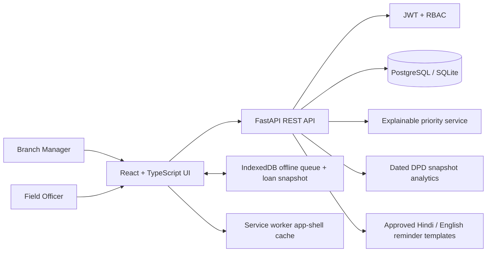

# CollectIQ Architecture

## Context

CollectIQ supports two primary actors: branch managers and field collection officers. The browser-based field interface is mobile-first; the manager workspace is desktop-friendly.

## Key trust boundaries

- The browser is an untrusted client. All permissions, assignment scope and contact-time checks are enforced by API dependencies/handlers.
- Offline events carry a UUID; the server checks uniqueness and verifies that a repeated UUID belongs to the same officer and loan.
- Loan and promise queries are scoped by officer assignment or manager branch.
- Reminder drafts are generated from fixed approved text templates. Approval is recorded as a mock event; no delivery connector exists.
- The AI score is advisory. Manual manager overrides require a reason and are audited.

## Data flow

1. Manager uploads a CSV; API validates rows and persists accepted loan data.
2. Assignment chooses a territory-matched active officer with the lowest current open-loan workload.
3. Officer fetches assigned loans; priority is calculated from DPD, amount, payment-history category and broken promises.
4. Officer logs outcome; API validates role, assignment, idempotency, timestamp window and payload.
5. Promise outcome creates a promise record; a past-due unfulfilled promise is marked broken when promise data is read.
6. Dated imports create DPD snapshots. Roll-rate analytics compare the latest two snapshots for the prior 1–30 DPD cohort.
7. Offline events are stored in IndexedDB and retried after reconnect.

## Main design decisions

- SQLAlchemy ORM and parameterised queries are used rather than string-built SQL.
- PostgreSQL is the Docker default; SQLite enables quick local development.
- A heuristic is used instead of claiming an untrained model is predictive.
- Roll-rate is unavailable until there is a valid historical cohort, rather than substituting a misleading current-bucket ratio.
- Calls and message delivery are mock adapters because no phone numbers or external credentials were supplied.
